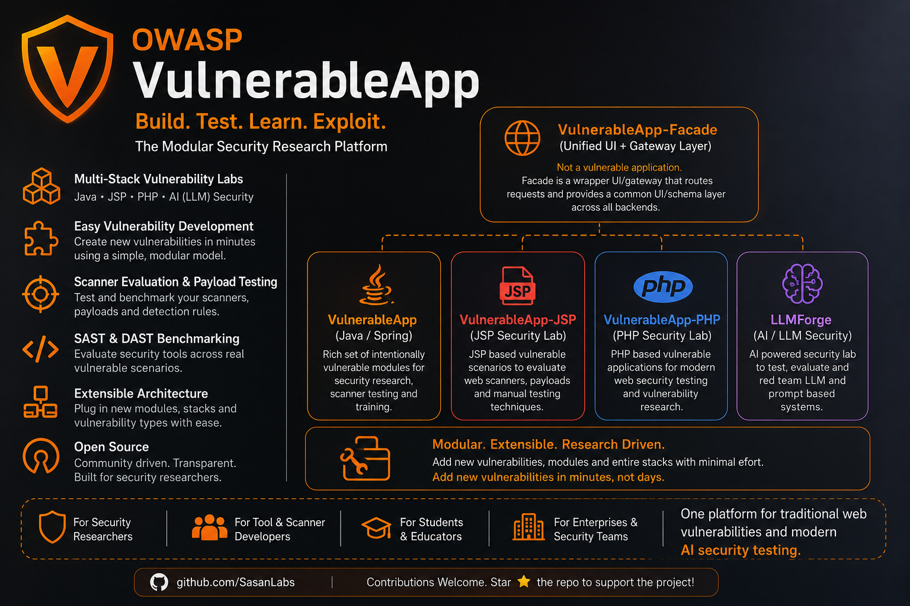
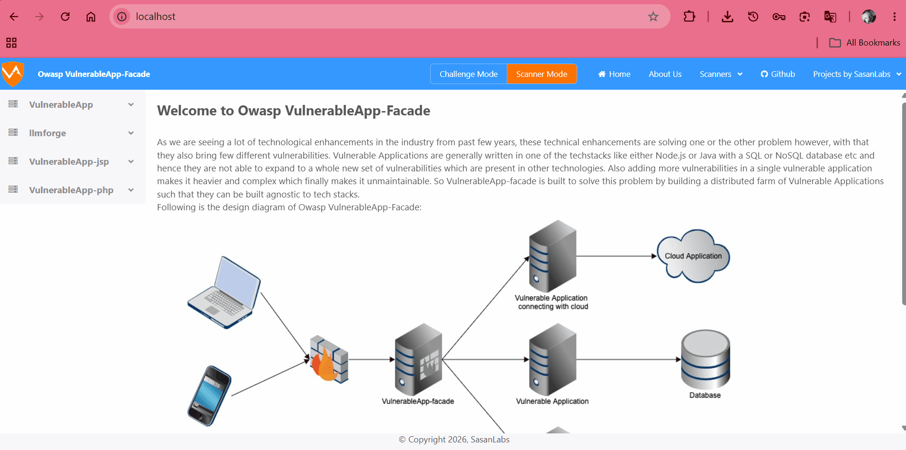
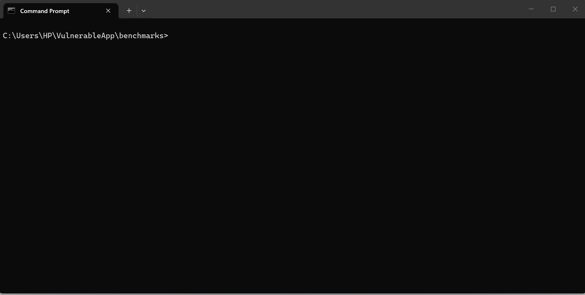

1| [English](README.md) | [Русский](docs/i18n/ru/README.md) | [中文](docs/i18n/zh-CN/README.md) | [हिन्दी](docs/i18n/hi/README.md) | [ਪੰਜਾਬੀ](docs/i18n/pu/README.md) |[...]
2| 
3| #  OWASP VulnerableApp
4| 
5|   [![License](https://img.shields.io/badge/Li[...]
6| 
7| ## Break it. Scan it. Reproduce it. Benchmark against it. Improve it.
8| 
9| OWASP VulnerableApp is a modular deliberately vulnerable application designed primarily for validating and benchmarking security scanners through reproducible test scenarios, while also supporting [...]
10| 
11| ### 🔍 What makes it different
12| Unlike traditional vulnerable applications, VulnerableApp is designed as a testable security ecosystem, not a static training app.
13| 
14| ### It enables:
15| 
16| - 🔬 Scanner benchmarking for tools like Burp Suite, OWASP ZAP, and custom DAST engines
17| - 🧩 Modular vulnerability design that allows new scenarios without modifying core services
18| - 📊 Security regression testing across releases and environments
19| - 🎯 Realistic attack surface simulation for modern web application patterns
20| - 🧪 Deterministic vulnerability behavior for repeatable scanning results
21| - 🧠 Built for security engineers, researchers, and educators
22| 
23| 
24| 
25| 
26| ### VulnerableApp helps you:
27| 
28| - Validate how security tools behave across known vulnerability patterns
29| - Build controlled environments for security experimentation
30| - Extend vulnerability coverage as new attack techniques emerge
31| - Run consistent, repeatable security testing pipelines
32| 
33| ### ⚙️ Why it matters
34| 
35| Most vulnerable apps are:
36| - Static
37| - Hard to extend
38| - Designed only for manual learning
39| 
40| ### VulnerableApp is built for:
41| automation, reproducibility, and evolution
42| 
43| ## 🎥 Video Overview
44| 
45| New to the project? Watch this OWASP Spotlight session for a high-level overview of VulnerableApp:
46| 
47| [OWASP Spotlight series: VulnerableApp overview](https://www.youtube.com/watch?v=hoCxzQQugZc&list=PLUKo5k_oSrfOTl27gUmk2o-NBKvkTGw0T)
48| 
49| ## User Interface
50| #### Challenge Mode
51| 
52| 
53| #### Switching Modes (Challenge & Scanner)
54| 
55| 
56| #### Scanner Mode Endpoints (DAST & SAST)
57| 
58| 
59| #### Scanner Mode Benchmark Comparator
60| 
61| 
62| ### Running the project
63| 
64| > [!WARNING]
65| > VulnerableApp is deliberately vulnerable. Run it only on your own machine, in a VM, or in a Docker container, and never expose it to the internet. See the [Security Policy](SECURITY.md) for what to [...]
66| 
67| There are 2 ways to run the project:
68| 1. The simplest way to run the project is using Docker containers which will run the full-fleged VulnerableApplication with all the components. For running as Docker application, follow following [...]
69|     1. Download and Install [Docker Compose](https://docs.docker.com/compose/install/) 
70|     2. Clone this Github repository
71|     3. Open the terminal and Navigate to the Project root directory
72|     4. Run the command ```docker-compose pull && docker-compose up```
73|     5. Navigate to browser and visit `http://localhost` and this will give the User Interface for VulnerableApp.
74|     6. Mailpit is also available at `http://localhost/mailpit/` for viewing emails captured by the local SMTP server.
75|     
76|     **Note**: The above steps will run the latest unreleased VulnerableApp version. If you want to run the latest released version, please use docker **latest** tag.
77| 2. Another way to run the VulnerableApp is as standalone Vulnerable Application is:
78|     1. Navigate to [Releases Section](https://github.com/SasanLabs/VulnerableApp/releases) in github and download the Jar for the latest released version
79|     2. Open the terminal and navigate to the project root directory
80|     3. Run the command ```java -jar VulnerableApp-*```
81|     4. Navigate to browser and visit `http://localhost:9090/VulnerableApp`. This will give the Legacy User Interface for the VulnerableApp.
82| 
83| ## Building the project
84| There are 2 ways in which this project can be built and used:
85| 1. As a Docker application which will help in running the full-fledged VulnerableApplication. For running as Docker application, follow following steps:
86|     1. Build the docker image by running `./gradlew jibDockerBuild`
87|     2. Download [Docker-Compose](https://github.com/SasanLabs/VulnerableApp-facade/blob/main/docker-compose.yml) and run in the same directory `docker-compose up`
88|     3. Navigate to browser and visit `http://localhost` and this will give the User Interface for VulnerableApp.
89| 2. As a SpringBoot application which will run with the Legacy UI or Rest API but gives the benefit of debugging and solving issues. This is the simple way, 
90|     1. Import the project into your favorite IDE and run it
91|     2. Navigate to browser and visit: `http://localhost:9090/VulnerableApp` and this will give the Legacy User Interface for VulnerableApp which you can use to debug and test.
92| 
93| ## Contributing to Project
94| 
95| There are multiple ways in which you can contribute to the project:
96| 1. If you are a developer and trying to start on to the project, then the suggestion is to go through the list of [issues](https://github.com/SasanLabs/VulnerableApp/issues) which contains `good first[...]
97| 2. If you are a developer or a security professional looking to add new Vulnerability type then you can Generate the Sample Vulnerability by running `./gradlew GenerateSampleVulnerability`. It wil[...]
98| 3. In case you are looking to contribute to the project by publicising it or working on the growth of the project, please feel free to add your thoughts to discussions section or issues and we can dis[...]
99| 
100| ## Testing with Modern UI
101| VulnerableApp-facade provides a modern UI for VulnerableApp. To test your local changes with the Modern UI:
102| 
103| 1. **Prerequisite**: Ensure you have Docker and Docker-Compose installed.
104| 2. **Run Testing Script**:
105|    - On Windows: `./scripts/testWithModernUI.bat`
106|    - On Linux/Mac: `./scripts/testWithModernUI.sh`
107| 
108| This script will build your local changes into a Docker image (`sasanlabs/owasp-vulnerableapp:unreleased`) and start the full stack (including facade, jsp, and php services) using `docker-compose[...]
109| 
110| 3. **Access the UI**: Navigate to `http://localhost` to see the modern UI with your changes.
111| 
112| 4. **Access Mailpit**: Navigate to `http://localhost/mailpit/` to view emails captured by the local SMTP server.
113| 
114| ## Technologies used
115| - Java17
116| - Spring Boot
117| - ReactJS
118| - Javascript/TypeScript
119|  
120| ### Connecting to embedded H2 database
121| For accessing database from browser, visit: `http://localhost:9090/VulnerableApp/h2`
122| 
123| Database Connection properties:
124| ```properties
125| JDBC Url: jdbc:h2:mem:testdb
126| User Name: admin
127| Password: hacker
128| ```
129| 
130| ## Currently handled Vulnerability types
131| 
132| 1. [JWT Vulnerability](https://github.com/SasanLabs/VulnerableApp/blob/master/src/main/java/org/sasanlabs/service/vulnerability/jwt/)
133| 2. [Command Injection](https://github.com/SasanLabs/VulnerableApp/tree/master/src/main/java/org/sasanlabs/service/vulnerability/commandInjection)
134| 3. [Cryptography Failures](https://github.com/SasanLabs/VulnerableApp/tree/master/src/main/java/org/sasanlabs/service/vulnerability/cryptographicFailures)
135| 4. [File Upload Vulnerability](https://github.com/SasanLabs/VulnerableApp/tree/master/src/main/java/org/sasanlabs/service/vulnerability/fileupload)
136| 5. [Path Traversal Vulnerability](https://github.com/SasanLabs/VulnerableApp/tree/master/src/main/java/org/sasanlabs/service/vulnerability/pathTraversal)
137| 6. [SQL Injection](https://github.com/SasanLabs/VulnerableApp/tree/master/src/main/java/org/sasanlabs/service/vulnerability/sqlInjection)
138|     1. [Error Based SQLi](https://github.com/SasanLabs/VulnerableApp/blob/master/src/main/java/org/sasanlabs/service/vulnerability/sqlInjection/ErrorBasedSQLInjectionVulnerability.java)
139|     2. [Union Based SQLi](https://github.com/SasanLabs/VulnerableApp/tree/master/src/main/java/org/sasanlabs/service/vulnerability/sqlInjection/UnionBasedSQLInjectionVulnerability.java)
140|     3. [Blind SQLi](https://github.com/SasanLabs/VulnerableApp/blob/master/src/main/java/org/sasanlabs/service/vulnerability/sqlInjection/BlindSQLInjectionVulnerability.java)
141| 7. [XSS](https://github.com/SasanLabs/VulnerableApp/tree/master/src/main/java/org/sasanlabs/service/vulnerability/xss)
142|     1. [Persistent XSS](https://github.com/SasanLabs/VulnerableApp/tree/master/src/main/java/org/sasanlabs/service/vulnerability/xss/persistent)
143|     2. [Reflected XSS](https://github.com/SasanLabs/VulnerableApp/tree/master/src/main/java/org/sasanlabs/service/vulnerability/xss/reflected)
144| 8. [XXE](https://github.com/SasanLabs/VulnerableApp/tree/master/src/main/java/org/sasanlabs/service/vulnerability/xxe)
145| 9. [Open Redirect](https://github.com/SasanLabs/VulnerableApp/tree/master/src/main/java/org/sasanlabs/service/vulnerability/openRedirect)
146|     1. [Http 3xx Status code based](https://github.com/SasanLabs/VulnerableApp/blob/master/src/main/java/org/sasanlabs/service/vulnerability/urlRedirection/Http3xxStatusCodeBasedInjection.java)
147| 10. [SSRF](https://github.com/SasanLabs/VulnerableApp/tree/master/src/main/java/org/sasanlabs/service/vulnerability/ssrf)
148| 11. [IDOR](https://github.com/SasanLabs/VulnerableApp/tree/master/src/main/java/org/sasanlabs/service/vulnerability/idor)
149| 12. [Clickjacking](https://github.com/SasanLabs/VulnerableApp/tree/master/src/main/java/org/sasanlabs/service/vulnerability/clickjacking)
150| 13. [LDAP Injection](https://github.com/SasanLabs/VulnerableApp/tree/master/src/main/java/org/sasanlabs/service/vulnerability/ldapInjection)
151| 14. [Authentication Vulnerability](https://github.com/SasanLabs/VulnerableApp/tree/master/src/main/java/org/sasanlabs/service/vulnerability/authentication)
152| 15. [Password Reset Vulnerability](https://github.com/SasanLabs/VulnerableApp/tree/master/src/main/java/org/sasanlabs/service/vulnerability/passwordReset)
153| 
154| ### First-time contributors
155| 
156| > [!NOTE]
157| > These links are intended for first-time contributors who want to explore common vulnerability categories and the broader CWE taxonomy.
158| >
159| > - [OWASP Vulnerability List](https://community.owasp.org/vulnerabilities/)
160| > - [CWE (Common Weakness Enumeration) List](https://cwe.mitre.org/scoring/index.html#top_n_lists)
161| 
162| ## Benchmarking your scanner
163| 
164| VulnerableApp ships a comparator that grades a scanner's findings against the
165| project's built-in ground truth and writes a coverage / missed / unmatched
166| report. Both DAST and SAST scanners are supported via the same endpoint:
167| 
168| 
169| 
170| - Endpoint: `POST http://<baseurl>/VulnerableApp/scanner/benchmark`
171| - Request body — pick the shape that matches your scanner:
172|   - DAST: `{ tool, scanType: "DAST", findings: [ { url, type, cwe, wascId } ] }` (`scanType` is optional and defaults to `DAST`; `type`/`cwe`/`wascId` are individually optional — any one axis matching[...]
173|   - SAST: `{ tool, scanType: "SAST", findings: [ { filePath, line, cwe, type } ] }`
174| - Response body and `benchmarks/<tool>-results.json` on disk: coverage report
175| - Ground truth: `GET http://<baseurl>/VulnerableApp/scanner/dast` for DAST and `GET http://<baseurl>/VulnerableApp/scanner/sast` for SAST. The bare `/scanner` path is deprecated and stays until 3[...]
176| 
177| Running the scanner itself is out of scope — you supply the JSON. See
178| [`benchmarks/README.md`](benchmarks/README.md) for the full input/output
179| schemas, matching rules, canonical vulnerability-type vocabulary, and `curl`
180| examples.
181| 
182| ## Contact
183| In case you are stuck with any of the steps or understanding anything related to project and its goals, read [Security Policy](SECURITY.md) if then also it is not resolved
184| feel free to shoot a mail at karan.sasan@owasp.org or raise an [issue](https://github.com/SasanLabs/VulnerableApp/issues), and we will try our best to help you.
185| 
186| ## Documentation and References
187| 
188| 1. [OWASP Spotlight series overview of project](https://m.youtube.com/watch?v=hoCxzQQugZc&list=PLUKo5k_oSrfOTl27gUmk2o-NBKvkTGw0T&pp=iAQB)
189| 2. [Overview video for OWASP Spotlight series](https://www.youtube.com/watch?v=HRRTrnRgMjs)
190| 3. [Documentation](https://sasanlabs.github.io/VulnerableApp)
191| 4. [Design Documentation](https://sasanlabs.github.io/VulnerableApp/DesignDocumentation.html)
192| 5. [Owasp VulnerableApp](https://owasp.org/www-project-vulnerableapp/)
193| 6. [Overview Video](https://www.youtube.com/watch?v=AjL4B-WwrrA&ab_channel=OwaspVulnerableApp)
194| 
195| ### Blogs
196| 1. [Overview of Owasp-VulnerableApp - Medium article](https://hussaina-begum.medium.com/an-extensible-vulnerable-application-for-testing-the-vulnerability-scanning-tools-cc98f0d94dbc)
197| 2. [Overview of Owasp-VulnerableApp - Blogspot post](https://hussaina-begum.blogspot.com/2020/10/an-extensible-vulnerable-application.html)
198| 3. [Introduction to Owasp VulnerableApp by Kenji Nakajima](https://jpn.nec.com/cybersecurity/blog/220520/index.html)
199| 4. [Gen AI based platform Shannon exploiting VulnerableApp](https://qiita.com/fiord/items/9351bcff6d646862f181)
200| 5. [I Built the OWASP ZAP File Upload Addon. Here’s Why VulnerableApp-Facade Had to Exist First](https://medium.com/p/52c4f2226ed3)
201| 
202| ### Usage of OWASP VulnerableApp
203| 1. [View Global Academic Interest](./docs/Usage.md)
204|    
205| ### Troubleshooting references
206| 1. [Reddit exploiting SQL Injection Vulnerability](https://www.reddit.com/r/hacking/comments/11wtf17/owasp_vulnerableappfacade_sql_injection/)
207| 
