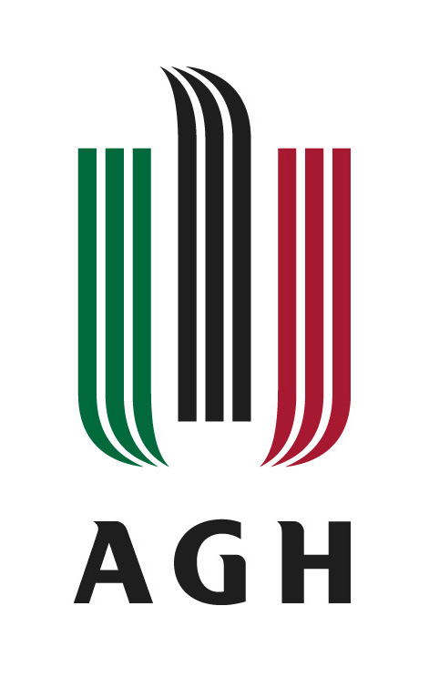
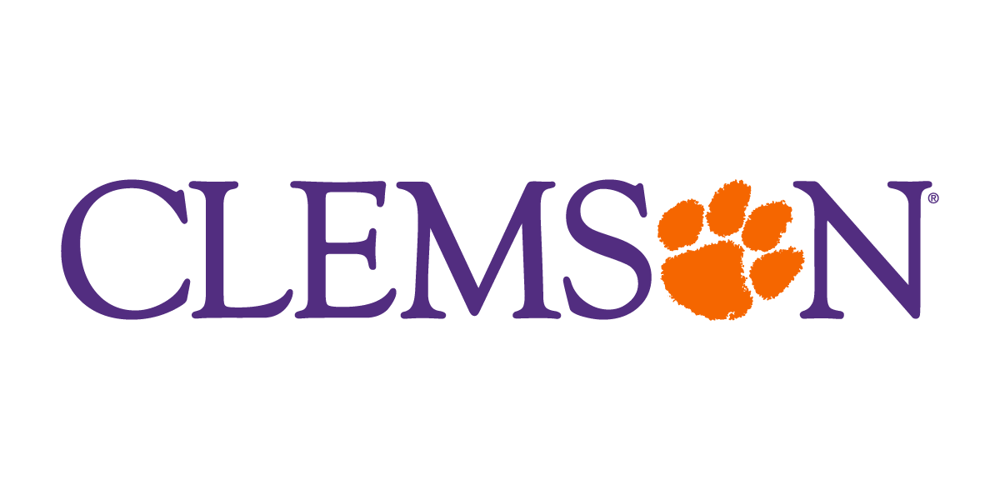

# External Usage & References

This page collects public links showing how OWASP VulnerableApp is used, evaluated, integrated, or discussed. Links are grouped by category; inclusion does not imply endorsement by the referenced organization.

## Research and Scanner Evaluation

- [SCAnME: Scanner Comparative Analysis and Metrics for Evaluation (2025) — International Journal of Information Security](https://link.springer.com/article/10.1007/s10207-025-01054-8)
- [Comparative Analysis of Open-Source Tools for Conducting Static Code Analysis (2023) — Sensors](https://pmc.ncbi.nlm.nih.gov/articles/PMC10535982/)

## Public Scanner Benchmarks

- [SekuScan — VulnerableApp benchmark results](https://www.sekuscan.com/benchmarks/)
- [SekuScan — raw VulnerableApp results (JSON)](https://www.sekuscan.com/benchmarks/vulnerableapp-results.json)

## AI-Powered Security Testing and Research

- [Autonomous AI pentesting with Shannon against VulnerableApp (2025) — Qiita](https://qiita.com/fiord/items/9351bcff6d646862f181)
- [Self-Supervised Detection of Unseen Command Injection Attacks Against OWASP VulnerableApp Using a Denoising Autoencoder — Slogix](https://slogix.in/projects/cybersecurity-industry-projects/cyber-project/ai-based-zero-day-attack-detection/self-supervised-detection-of-unseen-command-injection-attacks-against-owasp-vulnerableapp-using-a-denoising-autoencoder/)
- [Exploring Burp Suite Custom AI Agent using VulnerableApp (2026) — NEC Security Technology Center](https://group.nec/jp/ja/solutions/cybersecurity/blog/260807)

## OWASP Integrations

- [OWASP CTF-in-a-Box](https://owasp.org/projects/ctf-in-a-box)
- [OWASP CTF-in-a-Box — GitHub repository](https://github.com/OWASP/owasp-ctf-in-a-box)

## Enterprise Security Engineering

- [Contrast Security — Java Assess may record only the first route visited for some vulnerabilities](https://support.contrastsecurity.com/hc/en-us/articles/25992360843668-Java-Assess-may-record-only-the-first-route-visited-for-some-vulnerabilities)

## Academic and Institutional Interest

The project has received community interactions associated with students, educators, and researchers from the following institutions. This list does not imply institutional endorsement, formal deployment, or an official partnership.

- <a href="https://www.agh.edu.pl/en/"> <strong>AGH University of Kraków</strong></a> — Poland 🇵🇱
- <a href="https://nus.edu.sg/"> <strong>National University of Singapore</strong></a> — Singapore 🇸🇬
- <a href="https://www.univ-rouen.fr/university-of-rouen-normandy/"> <strong>University of Rouen Normandy</strong></a> — France 🇫🇷
- <a href="https://tecnico.ulisboa.pt/en/"> <strong>Instituto Superior Técnico, University of Lisbon</strong></a> — Portugal 🇵🇹
- <a href="https://case.edu/"> <strong>Case Western Reserve University</strong></a> — United States 🇺🇸
- <a href="https://www.clemson.edu/"> <strong>Clemson University</strong></a> — United States 🇺🇸
- <a href="https://umich.edu/"> <strong>University of Michigan</strong></a> — United States 🇺🇸
- <a href="https://www.adelaide.edu.au/"> <strong>University of Adelaide</strong></a> — Australia 🇦🇺
  
💬 **Students and contributors typically reach out for:**

* Contributing to the project
* Using it in coursework and research
* Learning practical application security

> ⚠️ Note: Mentions and logos are based on community interactions (e.g., student outreach,  contributions) and do not imply official institutional endorsement.

## Community and Related References

- [OWASP ZAP File Upload Add-on and VulnerableApp-Facade — technical article](https://medium.com/p/52c4f2226ed3)
- [SQL injection exploration in VulnerableApp-Facade — Reddit discussion](https://www.reddit.com/r/hacking/comments/11wtf17/owasp_vulnerableappfacade_sql_injection/)

## Articles

- [An extensible Vulnerable Application for testing vulnerability-scanning tools — Hussaina Begum (2020)](https://hussaina-begum.medium.com/an-extensible-vulnerable-application-for-testing-the-vulnerability-scanning-tools-cc98f0d94dbc).
- [Introduction to VulnerableApp — NEC Security Technology Center (2022)](https://group.nec/jp/ja/solutions/cybersecurity/blog/220520)

## Submit a Reference

If you use VulnerableApp in a research project, scanner evaluation, security training, CTF, or integration, open an issue or pull request with a link to the public reference.
